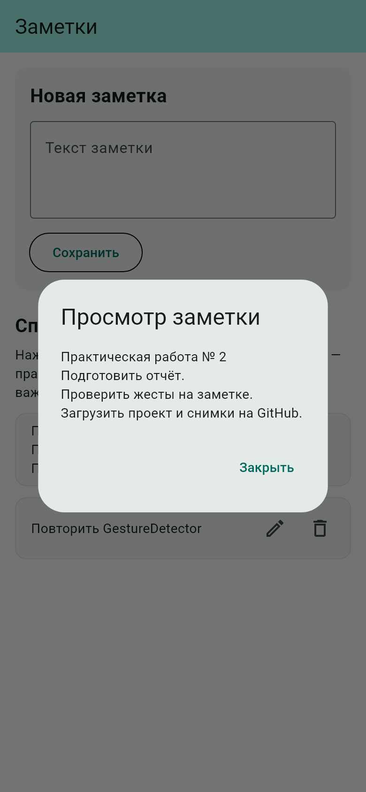
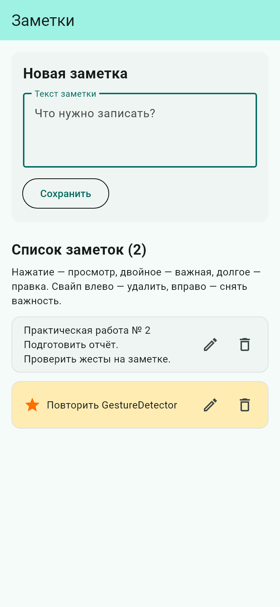
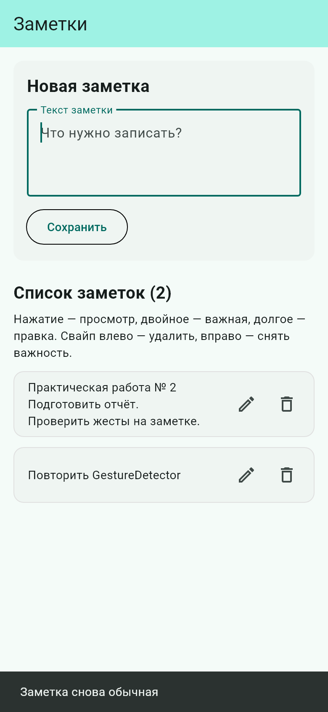
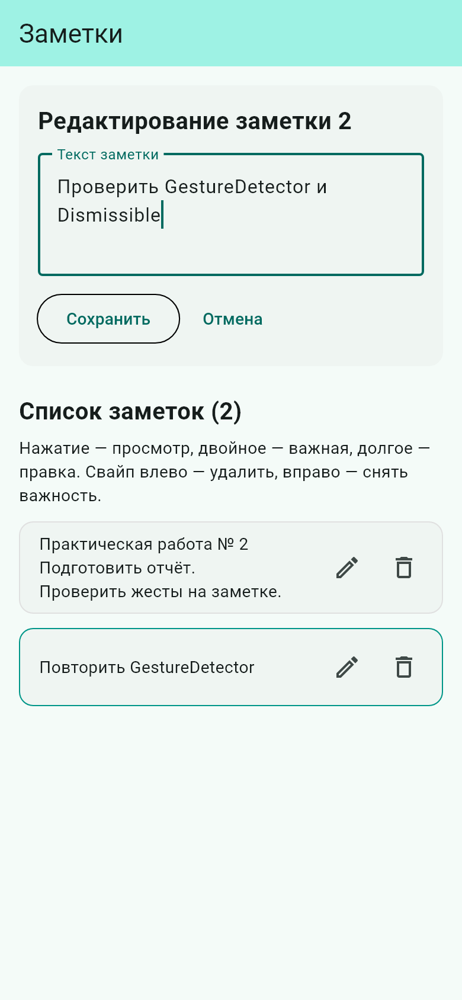
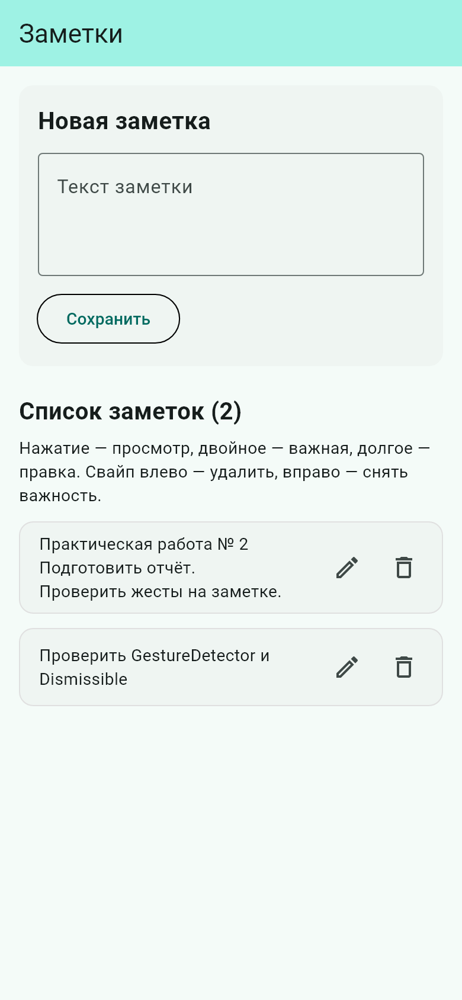
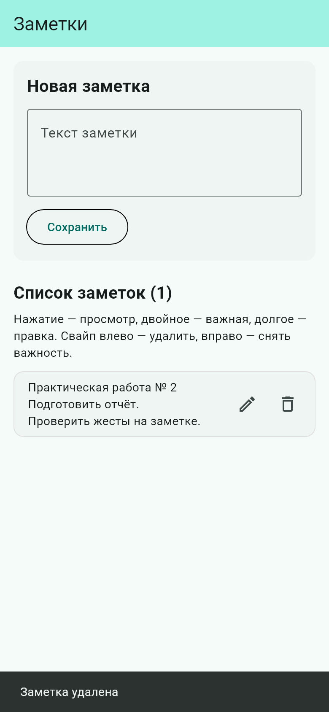

# Как работают жесты в «Заметках»

### Обычное нажатие открывает полный текст

На карточке видно три строки, а в окне просмотра видна и последняя строка заметки.

### Двойное нажатие и свайп вправо

| Двойное нажатие | Свайп вправо |
| --- | --- |
| Карточка становится жёлтой, появляется звезда. | Звезда и жёлтый фон исчезают. В списке остаются обе заметки. |
|  |  |

### Долгое нажатие и сохранение

| Долгое нажатие | После сохранения |
| --- | --- |
| Открывается форма редактирования второй заметки. | Новый текст появляется в той же карточке. В списке по-прежнему две заметки. |
|  |  |

### Свайп влево удаляет заметку

Вторая карточка исчезает, счётчик меняется с двух на одну, внизу появляется сообщение «Заметка удалена».

